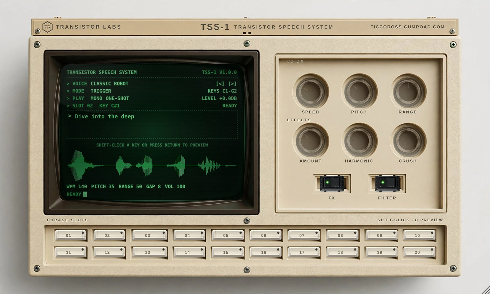

# TSS-1 — Transistor Speech System

A robotic text-to-speech instrument plug-in (AU / VST3 / LV2 / standalone) by **Transistor Labs**.
Type up to 20 phrases, play them from MIDI like samples, or play one phrase melodically so the machine
sings it in tune. The voice comes from **eSpeak-NG formant synthesis**, with no recordings and no AI models.



- 20 phrase slots on MIDI keys C1–G2 (root note adjustable), rendered in the background so notes play instantly
- **Trigger** mode (one-shots, mono/poly, one-shot/gate) and **Melodic** mode (the selected phrase tuned to every key)
- 26 voice presets after DJZ-Speak: retro computing, cinematic AI, modern and technical, character
- SPEED, PITCH, RANGE (intonation), word gap, voice volume
- Robot effects: FX and FILTER switches, AMOUNT, HARMONIC boost, CRUSH (bit and sample-rate reduction)
- Green-CRT retro computer UI: type phrases on the screen, live waveform and the spoken word; resizable 60–200 %
- Everything automatable and MIDI-mappable; phrases saved with the project

The manual is in [`docs/TSS-1 Manual.pdf`](docs/TSS-1%20Manual.pdf), and the changes are in
[`docs/TSS-1 Update History.pdf`](docs/TSS-1%20Update%20History.pdf).

## System requirements

- macOS 10.13 or later (Apple Silicon and Intel): AU, VST3, standalone
- Windows 10/11 64-bit: VST3, standalone
- Linux x86-64: VST3, LV2, standalone

## Building

Building runs on GitHub Actions only when asked: a commit message containing `[build]` makes the installers
as run artifacts; `[release]` (or a `v*` tag, or **Run workflow**) also publishes a GitHub Release.

Local build:

```
cmake -B build -DCMAKE_BUILD_TYPE=Release
cmake --build build --config Release
```

JUCE 8 and eSpeak-NG 1.52 are downloaded automatically. You can pass `-DJUCE_DIR=...` and `-DESPEAK_DIR=...` to use
local copies. `-DTSS_BUILD_TESTS=ON` adds `TSS1Test`, a headless test app that writes audio examples and editor snapshots.

| Path | What |
|---|---|
| `Source/` | the plug-in: processor, editor, eSpeak-NG service, presets |
| `assets/ui/` | UI images, made from `assets/source/` by `tools/prepare_assets.py` |
| `assets/espeak-ng-data.zip` | the English voice data embedded in the plug-in (`tools/build_espeak_data.sh`) |
| `docs/manual/build_docs.py` | builds the manual and the update history PDFs |
| `tools/make_pkg.sh`, `installer/windows/TSS-1.iss`, `tools/package_linux.sh` | installers |

## Licence and credits

TSS-1 is free software under the **GNU General Public License v3.0** (see `LICENSE`), because it includes
eSpeak-NG.

- [eSpeak-NG](https://github.com/espeak-ng/espeak-ng): speech synthesis, GPL-3.0
- [DJZ-Speak](https://github.com/MushroomFleet/ComfyUI-DJZ-Speak) by MushroomFleet: voice presets and the effects chain, Apache-2.0
- [JUCE](https://juce.com): plug-in framework, used under the GPL-3.0

Preset names describe voice styles. They are not affiliated with or endorsed by the owners of those names.

Contact: ticcoross@gmail.com · Store: https://ticcoross.gumroad.com/
